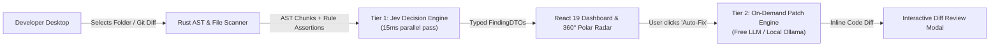

# 🛡️ CodeRadar Studio: Executive Summary & System Vision

> **Document ID:** `CR-SPEC-00`  
> **Status:** Ready for Architectural Review  
> **Target Platform:** Desktop App (Windows, macOS, Linux)  
> **Core Tech Stack:** Tauri 2.0 (Rust) + React 19 + Tailwind CSS + Jev Decision Engine  

---

## 1. Executive Summary

**CodeRadar Studio** is a high-performance developer desktop application designed to perform real-time, multi-dimensional code reviews, security vulnerability assessments, and Clean Architecture compliance checks.

Unlike traditional AI code reviewers that rely on slow, expensive, autoregressive LLMs (which take 5–15 seconds per file and cost significant output tokens), CodeRadar introduces a **Dual-Tier Review Architecture**:
1. **Tier 1 (Real-Time Radar Daemon):** Powered by **Jev** (TypeSafe AI's decision model) to evaluate deterministic, type-safe rule assertions across project files with **zero text generation overhead**. Latency is **10–35 ms per chunk** in the built-in **Mock/heuristic engine** (the default, offline, "instant" path), or **~0.5–0.6 s per chunk** against **live Jev** (a background deep scan, ~$0.00015/chunk) — measured in [`CR-SPEC-08`](./08-PHASE-0-SPIKE-AND-DECISIONS.md) §3.
2. **Tier 2 (On-Demand Deep Fixer):** An optional, user-triggered generative patch engine (e.g. Gemini 2.0 Flash Free Tier or local Ollama) that writes precise code diffs only when a user explicitly requests an Auto-Fix.

The user interface is inspired by high-density security platforms (such as Stripe Radar), featuring an interactive **360° Polar Radar Canvas**, live KPI cards, severity filtering, and structured findings with CWE classification.

---

## 2. Key Problem Statements & Solutions

| Challenge | Traditional AI Reviewers | CodeRadar Studio Solution |
| :--- | :--- | :--- |
| **Review Latency** | 3–15 seconds per file; unusable for whole projects. | **10–35 ms/chunk** instantly in Mock mode; **~0.5–0.6 s/chunk** against live Jev as a background scan (**~5–7 min and ~$1 per 5,000-file repo**) — measured in [`CR-SPEC-08`](./08-PHASE-0-SPIKE-AND-DECISIONS.md). |
| **Operational Cost** | High cost driven by continuous output token generation. | **Near $0.00**; Jev generates zero output text tokens. |
| **Hallucination Risk** | LLMs hallucinate non-existent security flaws or invent rules. | **Deterministic Type-Safety**: Jev evaluates strict Boolean/Enum assertions. |
| **Rule Redundancy** | Disconnected, overlapping review skills create noisy feedback. | **Unified Review Matrix**: Deduplicated synthesis of top open-source skills. |
| **Privacy & Security** | Entire source code sent unconstrained to cloud LLMs. | **Local AST Pre-filtering**: Only relevant AST tokens and diffs are evaluated. |

---

## 3. High-Level System Workflow

---

## 4. Documentation Package Overview

This specification package contains all documents required for independent architectural and engineering review:

1. [`01-BRD-AND-MVP-REQUIREMENTS.md`](./01-BRD-AND-MVP-REQUIREMENTS.md): Business requirements, user personas, MVP scope boundaries, and acceptance criteria.
2. [`02-CLEAN-ARCHITECTURE-BLUEPRINT.md`](./02-CLEAN-ARCHITECTURE-BLUEPRINT.md): Strict Clean Architecture compliance, dependency direction, domain isolation, and Rust/Tauri adapter layers.
3. [`03-JEV-DECISION-ENGINE-INTEGRATION.md`](./03-JEV-DECISION-ENGINE-INTEGRATION.md): Deep dive into Jev schema design, latency optimization, parallel chunking, and local mock server.
4. [`04-UNIFIED-REVIEW-SKILLS-MATRIX.md`](./04-UNIFIED-REVIEW-SKILLS-MATRIX.md): Harmonized and deduplicated synthesis of the 6 downloaded review skills across 5 core domains.
5. [`05-UI-UX-AND-POLAR-RADAR-SPEC.md`](./05-UI-UX-AND-POLAR-RADAR-SPEC.md): Complete UI layout specification, Polar coordinate math, and interactive state models.
6. [`06-INDEPENDENT-AI-REVIEW-PROMPT.md`](./06-INDEPENDENT-AI-REVIEW-PROMPT.md): Turnkey review prompt specifically designed for feeding these specs into an external AI model for rigorous review.
