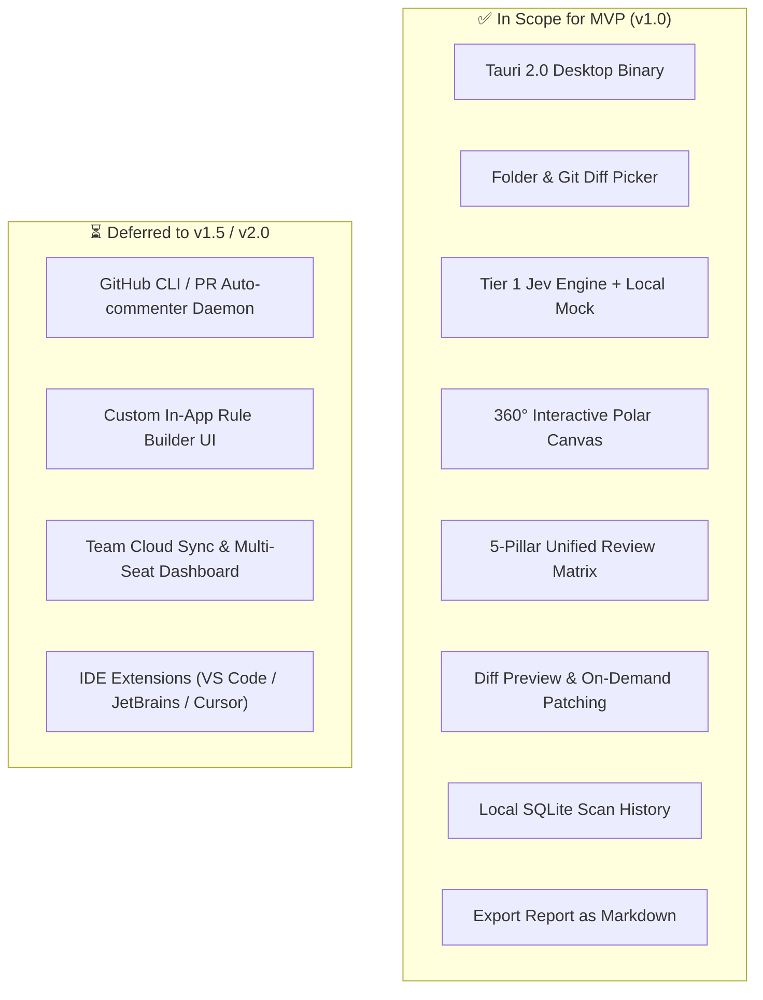

# 📋 CodeRadar Studio: Business Requirements Document (BRD) & MVP Scope

> **Document ID:** `CR-SPEC-01`  
> **Status:** Ready for Architectural Review  
> **Version:** 1.0.0-MVP  

---

## 1. Project Objectives

1. **Instantaneous Code Review:** Deliver comprehensive code audits in seconds rather than minutes.
2. **Deterministic Quality Enforcement:** Evaluate codebase against 5 core engineering pillars (Clean Architecture, Security, Edge Cases, Performance, and PR Hygiene).
3. **Low-Footprint Desktop Delivery:** Package as a native desktop binary consuming `< 45MB` Rust backend RSS on idle and zero cloud token waste.
4. **Actionable Remediation:** Surface findings with verified AST line spans / exact lines, CWE tags, confidence scores, and one-click diff remediations.

---

## 2. Target User Personas

| Persona | Primary Goal | Pain Point Addressed |
| :--- | :--- | :--- |
| **Staff/Lead Architect** | Enforce Clean Architecture & The Dependency Rule across teams. | Architectural drift; controllers and UI directly querying DB or domain entities escaping boundary. |
| **Senior Software Engineer** | Pre-PR sanity check to catch subtle edge cases and race conditions. | Code works on happy path but crashes on unhandled promise or null pointer in production. |
| **Security Engineer** | Identify CWE violations (SQLi, hardcoded tokens, insecure headers). | Slow, noisy static analysis tools with high false-positive rates. |

---

## 3. Functional Requirements (FR)

### FR-01: Workspace & Target Selection
- The user can pick any local project folder using native OS file dialog.
- The user can toggle between **Full Project Scan** and **Git Staged Diff Scan**.
- The scanner detects project tech stack automatically (TypeScript, React, Python, Go, Rust, Java, etc.).

### FR-02: Real-Time Radar Visualization
- Display an interactive **360° Polar Canvas Radar**.
- Threat nodes rendered at polar coordinates $(r, \theta)$ where:
  - $r \in [0.0, 1.0]$ represents calculated risk score ($0.0 = \text{Center (Safe Threshold)}$, $1.0 = \text{Critical Outer Boundary}$).
  - $\theta \in [0^\circ, 360^\circ]$ corresponds to the functional category quadrant with deterministic angular hash dispersion.
  - **Node Omission Invariant:** Only active findings (`LOW`, `MEDIUM`, `HIGH`, `CRITICAL`) are plotted as individual canvas nodes. `Clean` files do not generate nodes (preventing center clutter of thousands of dots); clean passes are visualized via ambient HUD pulses and the live metric ribbon.
- **Scanning & Visualization Modes:**
  - **Full Project Scan Mode:** 4 orthogonal quadrants ($90^\circ$ each: Clean Architecture, Security, Edge Cases, Performance).
  - **PR / Git Diff Mode:** Concentrates on modified lines and stages, surfacing a dedicated Pull Request Hygiene gauge & matrix.
- Animated sweeping needle simulating real-time radar daemon passes via dual-layer canvas decoupled from React state.

### FR-03: Multi-Category Findings & Severity Filtering
- Live metric ribbon displaying: `Total Analyzed LOC`, `Under Review`, `Auto-Resolved`, `Clean Passed %`, `Threats Blocked`.
- Filter findings by severity: `ALL`, `CRITICAL`, `HIGH`, `MEDIUM`, `LOW`.
- Filter findings by category: `Clean Architecture`, `Security`, `Edge Cases`, `Performance`, `Pull Requests`.

### FR-04: Tier 1 Semantic Rule Evaluation
- Every code chunk is evaluated via typed assertion schema.
- Latency target: **10–35 ms per chunk** under the local **Mock engine** (default, offline). Against **live Jev** (background deep scan), the measured budget is **≈ 0.5–0.6 s per chunk warm** (~0.9 s cold), **one decision per chunk**, ~$0.00015/chunk — a 5,000-file repo is **minutes and ~$1**, not real-time. See [`CR-SPEC-08`](./08-PHASE-0-SPIKE-AND-DECISIONS.md) §3–§5 — the earlier "12–35 ms per chunk against live Jev" claim is not supported and was corrected.
- Response parsing yields structured `FindingDTO` containing file, verified AST chunk line range (e.g. `lines 35-85`) or exact line when resolved by Tier 0, CWE id, confidence, and rule metadata resolved locally from `manifest.json`.
- Strict Zero Text Generation: Semantic engine returns exclusively Enums, Booleans, and Numbers.

### FR-05: Tier 2 Interactive Remediation & Diff Preview
- Clicking any finding or the `[Auto-Fix]` action triggers an inspection drawer.
- Shows side-by-side or unified code diff comparing current faulty code with recommended fix.
- User can accept patch to overwrite file or copy diff to clipboard.
- **Concurrency & Safety Invariant:** Patch application performs an optimistic concurrency check (verifying file SHA-256 matches scan-time state) and executes via atomic file write (temp file write + atomic rename) to eliminate corruption.

### FR-06: Local Persistence & Scan History
- Local **SQLite** database records every scan session asynchronously.
- Tracks project quality trends over time (e.g., Clean Architecture compliance increased from 88% to 94.2%).

### FR-07: Markdown Report Export
- The user can export the current scan (findings, severities, CWE tags, radar metrics, and scan metadata) as a structured **Markdown** report.
- Priority: **P1 within MVP (v1.0)**, delivered in Phase 7. This requirement backs the `F8` scope-matrix entry ("Export Report as Markdown") that previously had no corresponding FR — see [`CR-SPEC-08`](./08-PHASE-0-SPIKE-AND-DECISIONS.md) §7.3.

---

## 4. Non-Functional Requirements (NFR)

| ID | Category | Requirement |
| :--- | :--- | :--- |
| **NFR-01** | **Performance** | Desktop app cold start in `< 1.2s`. Rust Core Backend RSS `< 45MB` on idle; Webview renderer process isolated and bounded by OS webview runtime. |
| **NFR-02** | **Privacy & Redaction** | **Local-First Default:** CodeRadar operates in 100% offline mode using local heuristics unless Cloud Evaluation is explicitly toggled by user. **Automated Secret Redaction:** Tier 0 regex scrubs high-entropy credentials, tokens, and secrets (`[REDACTED_SECRET]`) before any cloud payload is sent. **Tier 2 Transparency:** User selects between local Ollama (100% private) and cloud LLMs with explicit provider privacy policy disclosures. |
| **NFR-03** | **Offline Resilience** | Includes built-in Local Mock / Heuristic engine to allow full UI and scan execution without active internet. Mock mode is clearly labeled with a warning badge in the status bar. |
| **NFR-04** | **Platform Support** | Windows 10/11 x64, macOS (Apple Silicon & Intel), and Linux (Ubuntu 22.04+). |
| **NFR-05** | **Desktop AppSec** | **Path Traversal Guard:** File writes are restricted to selected workspace root; attempts to write outside or follow symlinks escaping root are blocked. **Keychain Secret Storage:** API keys are stored in OS Keychain (Windows Credential Manager, macOS Keychain, Linux Secret Service via `keyring-rs`), never plaintext files. **Webview CSP:** Strict Content Security Policy with disabled external script execution. |

---

## 5. Scope Matrix: MVP (v1.0) vs Future Releases

