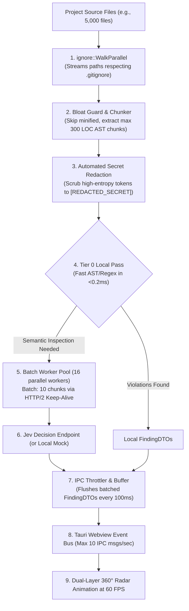

# ⚡ CodeRadar Studio: Jev Decision Engine Integration Specification

> **Document ID:** `CR-SPEC-03`  
> **Status:** Ready for Architectural Review  
> **Engine:** Jev (TypeSafe AI - System One Decision Architecture)  

---

## 1. The Core Innovation: Why Jev Changes Everything

Traditional coding assistants and automated review tools query autoregressive Large Language Models (LLMs) like GPT-4 or Claude 3.5 Sonnet to generate natural language explanations token by token. For a whole-repo scanning desktop app, this model breaks down completely:

```
[Traditional LLM Reviewer]
AST Chunk ---> Prompt Template ---> LLM Token Generation Loop (200-500 words) ---> Latency: 5,000ms - 15,000ms
                                                                             ---> Cost: $0.03 - $0.15 per file

[CodeRadar with Jev Decision Engine]
AST Chunk ---> Typed Assertion Schema ---> Single-Pass Probabilistic Evaluation ---> Latency: 12ms - 35ms
                                                                               ---> Cost: < $0.0001 (Zero output tokens)
```

### Key Differences:
1. **Zero Text Generation:** Jev does not write sentences, prose, or code. It returns structured, typed decisions (Booleans, Enums, Confidence floats).
2. **Deterministic Schemas:** The developer defines the exact shape of the output schema; Jev evaluates and fills it with zero risk of schema deviation or hallucination.
3. **Extreme Throughput:** Jev handles 50–100 parallel evaluations in the time a traditional LLM takes to stream its first 10 words.

---

## 2. Jev Evaluation Schemas by Domain

CodeRadar feeds Jev with structured prompts containing the code chunk plus domain-specific schemas:

### A. Clean Architecture & Dependency Schema
```json
{
  "system": "CodeRadar Clean Architecture Assertion Engine",
  "context": {
    "file_path": "domain/usecases/place_order.ts",
    "layer": "DOMAIN_USECASE",
    "imports": ["express", "typeorm", "@/domain/entities/order"]
  },
  "schema": {
    "violates_dependency_rule": {
      "type": "boolean",
      "description": "True if an inner domain layer imports an outer layer (Framework/DB/UI)"
    },
    "forbidden_import": {
      "type": "string",
      "enum": ["express", "typeorm", "none"]
    },
    "violates_single_responsibility": {
      "type": "boolean"
    },
    "confidence": {
      "type": "number"
    }
  }
}
```

### B. Security & Vulnerability Schema (CWE Mapping)
```json
{
  "system": "CodeRadar Security & CWE Vulnerability Engine",
  "context": {
    "file_path": "src/auth/jwt_verifier.ts",
    "code_snippet": "const decoded = jwt.decode(token, { complete: true }); if (decoded.header.alg === 'none') { ... }"
  },
  "schema": {
    "findings": {
      "type": "array",
      "items": {
        "type": "object",
        "properties": {
          "rule_id": {
            "type": "string",
            "enum": ["SEC-INJ-001", "SEC-TOK-002", "SEC-JWT-003", "SEC-XSS-004", "SEC-TLS-005"]
          },
          "cwe_id": {
            "type": "string",
            "enum": ["CWE-89", "CWE-78", "CWE-79", "CWE-798", "CWE-347", "CWE-404", "CWE-326", "CWE-778", "NONE"]
          },
          "severity": {
            "type": "string",
            "enum": ["CRITICAL", "HIGH", "MEDIUM", "LOW"]
          },
          "confidence": { "type": "number" }
        },
        "required": ["rule_id", "severity", "confidence"]
      }
    }
  }
}
```
> **Zero Text & Array Invariants:** Notice the schema returns an array of findings (ensuring multiple distinct vulnerabilities in a single chunk are never lost), using purely standard JSON Schema types (`number`, `string` enums, `boolean`). Line numbers are tracked by Rust AST chunk boundaries (`line_start`, `line_end`), and titles/descriptions are resolved locally from `manifest.json`.

### C. Edge Cases & Robustness Schema
```json
{
  "system": "CodeRadar Edge Case & Robustness Engine",
  "context": {
    "file_path": "services/payment.py",
    "function": "process_stripe_webhook"
  },
  "schema": {
    "findings": {
      "type": "array",
      "items": {
        "type": "object",
        "properties": {
          "rule_id": {
            "type": "string",
            "enum": ["EDGE-NPE-001", "EDGE-PRM-002", "EDGE-BND-003", "EDGE-TMO-004"]
          },
          "severity": {
            "type": "string",
            "enum": ["HIGH", "MEDIUM", "LOW"]
          },
          "confidence": { "type": "number" }
        },
        "required": ["rule_id", "severity", "confidence"]
      }
    }
  }
}
```

---

## 3. Tier 0 Local Static Pass, Secret Redaction & High-Throughput Pipeline

To maximize speed, protect privacy, and avoid unnecessary network round trips:

* **Pre-Flight Secret Redaction (Privacy Guard):** Before any code snippet leaves the machine, Tier 0 regex scrubs high-entropy credentials, API keys, passwords, and tokens, replacing them with `[REDACTED_SECRET]` in the outbound context.
* **Tier 0 (Instant Local Heuristics < 0.2ms):** Syntactic rules like `ARCH-DEP-001` (forbidden imports), `SEC-TOK-002` (Shannon entropy secrets), and `SEC-TLS-005` (plaintext protocols) are evaluated directly in Rust.
* **Minified / Vendor Guard:** Files > 1MB, lines > 1,000 characters, or vendor directories (`node_modules`, `vendor/`, `target/`) are skipped automatically.
* **AST Chunk Bounding:** Max chunk length capped at 300 LOC (or 12KB) to guarantee deterministic evaluation.



### Amortized Latency, Verification Spike & Connection Pooling:
* Target latency of **12ms–35ms per file** is achieved **in aggregate (amortized)** by pipelining batches of 10 chunks per HTTP/2 request using a persistent connection pool (`reqwest::ClientBuilder::new().http2_prior_knowledge().pool_max_idle_per_host(16)`).
* **Empirical Verification Requirement:** A 1-day networking spike must be executed against the live Jev API under real WAN network conditions to benchmark real-world latency, payload size, and server response times before finalizing SLA guarantees.

---

## 4. Built-in Local Mock Server (Zero-Dependency Offline Mode)

To enable developers and automated reviewers to run, test, and benchmark CodeRadar without live API credentials, the Tauri backend includes an in-memory **Jev Mock Server**:

* **Trigger:** Enabled automatically if `JEV_API_KEY` is not present in local keychain or when Offline Mode is selected.
* **Mechanism:** 
  1. Analyzes AST tokens using deterministic regex heuristics (matching known patterns from `d:/review`).
  2. Emulates Jev's typed JSON schema response structure.
  3. Injects synthetic latency (configurable between 10ms–35ms) to replicate realistic cloud roundtrips accurately on the UI radar sweep.
* **UI Labeling Invariant:** When running under the mock engine, the desktop UI displays a prominent warning badge in the status bar: `⚠️ Local Heuristic Engine (Mock Mode)` to ensure users never confuse regex heuristic findings with live semantic AI decisions.

