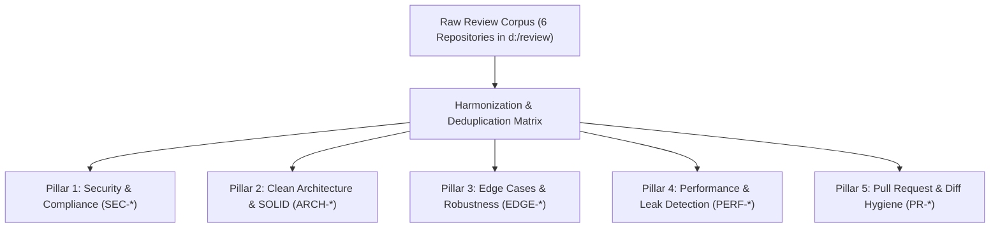

# 🧩 CodeRadar Studio: Unified Review Skills Matrix & Deduplication Strategy

> **Document ID:** `CR-SPEC-04`  
> **Status:** Ready for Architectural Review  
> **Source Corpus:** Synthesized from `d:\review` (Matt Pocock, Awesome Skills, Jesse Vincent Superpowers, Copilot Refactor, Alibaba Open Code Review, Spillwave PR Reviewer)  

---

## 1. Deduplication Rationale & Problem Analysis

In raw form, the 6 imported review repositories contained significant overlaps:
* **Security Redundancy:** Both Alibaba's `rule.json` and Awesome Skills' `reference/cross-cutting/` independently checked for SQL injection and XSS.
* **Architecture Redundancy:** Copilot's `review-and-refactor` and Awesome Skills' `architecture-review-guide.md` duplicate SOLID and DRY principles.
* **Edge Case Overlap:** Matt Pocock's `code-review/SKILL.md` and Awesome Skills' `common-bugs-checklist.md` duplicate null-check and unhandled promise audits.

**The Solution:** Extract the high-value essence ("الزبدة / Blueprint") into **5 orthogonal, non-overlapping pillars** mapped 1:1 to the CodeRadar user interface tabs:



---

## 2. Pillar 1: Security & Compliance (`SEC-*`)
*Target UI Tab:* **Security** | *Icon:* 🛡️

| Rule ID | Rule Title | CWE | Severity | Synthesized From | Core Assertion for Jev |
| :--- | :--- | :--- | :--- | :--- | :--- |
| `SEC-INJ-001` | SQL / Command Injection | CWE-89 / CWE-78 | CRITICAL | Alibaba + Awesome | Raw user input concatenated into query string or shell exec without parameterization. |
| `SEC-TOK-002` | Hardcoded Secrets & API Keys | CWE-798 | CRITICAL | Spillwave + Alibaba | High-entropy strings matching API token signatures (AWS, Stripe, JWT secret) in source. |
| `SEC-JWT-003` | Unvalidated JWT Header / Alg None | CWE-347 | CRITICAL | Alibaba | JWT verification accepting `alg: none` or unverified signature payloads. |
| `SEC-XSS-004` | Cross-Site Scripting (Reflected/DOM) | CWE-79 | HIGH | Awesome Skills | Unescaped dynamic rendering in HTML/JSX without sanitization. |
| `SEC-TLS-005` | Permissive TLS Cipher / Insecure Protocol | CWE-326 | LOW | Alibaba / Helm | Ingress or client config accepting TLS 1.0/1.1 or plaintext HTTP fallbacks. |

---

## 3. Pillar 2: Clean Architecture & SOLID (`ARCH-*`)
*Target UI Tab:* **Architecture** | *Icon:* 🏛️

| Rule ID | Rule Title | Architectural Invariant | Severity | Synthesized From | Core Assertion for Jev |
| :--- | :--- | :--- | :--- | :--- | :--- |
| `ARCH-DEP-001` | The Dependency Rule Violation | Dependencies must point strictly inward. | HIGH | Clean Arch Core + Copilot | Inner Domain/UseCase module directly imports outer UI/Controller, ORM, or Framework. |
| `ARCH-SRP-002` | God Class / SRP Violation | Single Responsibility Principle. | MEDIUM | Copilot + Awesome | Single class or module handling both business logic, data persistence, and network presentation. |
| `ARCH-DIP-003` | Concretion Coupling over Abstraction | Dependency Inversion Principle. | MEDIUM | Clean Arch Core | High-level use case instantiates concrete infrastructure adapters instead of depending on abstractions/interfaces. |
| `ARCH-BND-004` | Domain Entity Leakage across Boundary | Data Boundary Invariant. | HIGH | Clean Arch Core | Internal enterprise domain entities exposed directly as external HTTP/API responses instead of simple DTOs. |

---

## 4. Pillar 3: Edge Cases & Robustness (`EDGE-*`)
*Target UI Tab:* **Edge Cases** | *Icon:* ⚡

| Rule ID | Rule Title | Defect Category | Severity | Synthesized From | Core Assertion for Jev |
| :--- | :--- | :--- | :--- | :--- | :--- |
| `EDGE-NPE-001` | Null / Undefined Safety Gap | Runtime Crash | HIGH | Matt Pocock + Alibaba | Accessing properties on nullable objects without optional chaining (`?.`) or explicit guard. |
| `EDGE-PRM-002` | Unhandled Promise Rejection | Silent Failure | MEDIUM | Matt Pocock + Awesome | Asynchronous promise without `.catch()` or `try/catch` block causing unhandled crash. |
| `EDGE-BND-003` | Boundary Value Omission (0, Empty, Max) | Logic Flaw | MEDIUM | Matt Pocock Spec | Array indexing or division without bounds/empty check or integer overflow prevention. |
| `EDGE-TMO-004` | Missing Network / I/O Timeout | Resource Hang | MEDIUM | Awesome Skills | External HTTP/RPC call initiated without timeout configuration or abort signal. |

---

## 5. Pillar 4: Performance & Resource Leaks (`PERF-*`)
*Target UI Tab:* **Scanning Radar (Integrated)** | *Icon:* 🚀

| Rule ID | Rule Title | Defect Category | Severity | Synthesized From | Core Assertion for Jev |
| :--- | :--- | :--- | :--- | :--- | :--- |
| `PERF-NPO-001` | N+1 Query in Loop | Database Bottleneck | HIGH | Awesome Skills | Database query or ORM fetch executed sequentially inside an iteration loop. |
| `PERF-HDL-002` | Unreleased Connection Handle | CWE-404 Leak | MEDIUM | Alibaba Rules | Database connection or file descriptor acquired without guaranteed release in `finally` block. |
| `PERF-EVT-003` | Detached Event Listener / Hook Leak | Memory Leak | LOW | Awesome Skills (React) | Component event listener or subscription not unregistered during unmount lifecycle. |

---

## 6. Pillar 5: Pull Request & Diff Hygiene (`PR-*`)
*Target UI Tab:* **Pull Requests** | *Icon:* 📦

| Rule ID | Rule Title | PR Metric | Severity | Synthesized From | Core Assertion for Jev |
| :--- | :--- | :--- | :--- | :--- | :--- |
| `PR-SCP-001` | Scope Creep / Bloated PR | Reviewability | MEDIUM | Spillwave + Jesse Vincent | PR modifies > 500 lines across unrelated domain boundaries. |
| `PR-BRK-002` | Breaking API Contract Change | Backward Compatibility | HIGH | Spillwave + Matt Pocock | Public method signature altered, removing required parameters without version deprecation. |
| `PR-TST-003` | Missing Test Coverage for New Features | Verification Gap | MEDIUM | Jesse Vincent Protocol | Production code added without accompanying unit or integration test assertions. |

---

## 7. Versioning, Cryptographic Signing & Ruleset Manifest (`manifest.json`)

To enable seamless, tamper-proof Over-the-Air (OTA) rule updates without recompiling the desktop binary:

```json
{
  "ruleset_version": "2026.1.0-strict",
  "generated_at": "2026-10-16T21:40:00Z",
  "total_rules": 19,
  "categories": ["security", "architecture", "edge_cases", "performance", "pull_requests"],
  "signature": "ed25519:8f6a9c12e5d4...verified_by_coderadar_authority"
}
```

> **Cryptographic Verification Invariant:** A plain hash (like SHA-256) is insufficient for OTA security because an attacker could modify rules and recompute the hash. CodeRadar verifies ruleset updates against an **asymmetric Ed25519 public key** embedded directly in the compiled desktop binary. If the signature does not verify, the update is rejected.

---

## 8. Rule Evaluation Scopes & Execution Engines

Rules operate across three distinct architectural scopes depending on required context:

| Scope | Rules | Execution Engine | Context Required |
| :--- | :--- | :--- | :--- |
| **AST Chunk Scope** | `SEC-*`, `EDGE-*`, `ARCH-SRP-002` | Tier 1 (Jev / Semantic Evaluator) + Tier 0 | Single function / class block (up to 300 LOC). |
| **File / Module Scope** | `ARCH-DEP-001`, `ARCH-BND-004`, `PERF-HDL-002` | Tier 0 (Rust Tree-sitter + Layer Map) | Full file imports, `.coderadar.json` layer boundaries. |
| **Git Changeset Scope** | `PR-SCP-001`, `PR-BRK-002`, `PR-TST-003` | Rust Git Engine (`git2` / CLI) | Git diff statistics, modified public APIs, accompanying `_test` files. |
