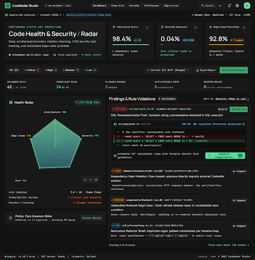
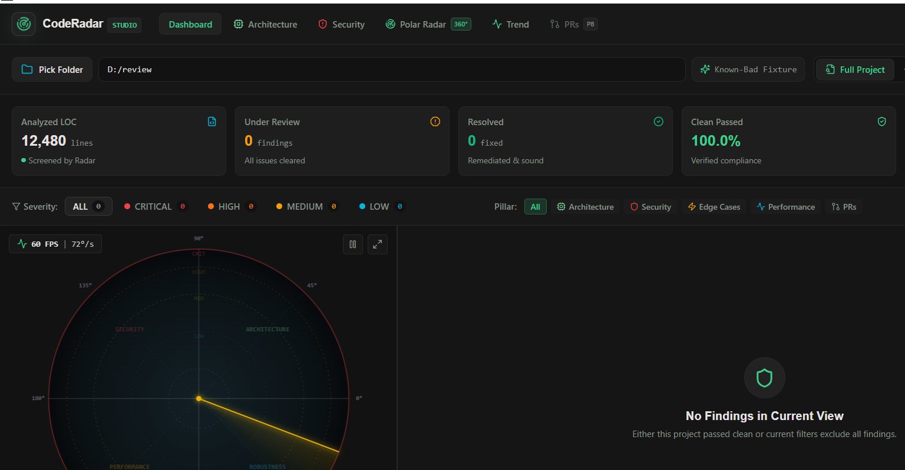
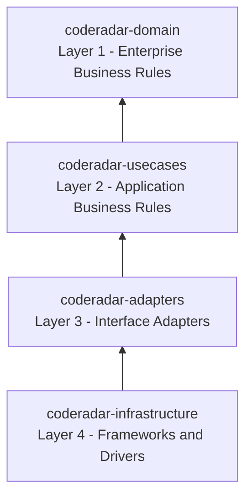
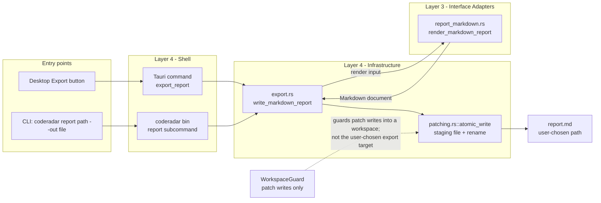

# CodeRadar Studio

CodeRadar Studio is a local-first desktop code and security radar. It scans a
workspace on your machine against a fixed ruleset of 19 rules, projects every
finding onto a 360° polar radar, and lets you review and apply deterministic
fixes as unified diffs. The engine is a Rust workspace built on Clean
Architecture; the shell is a Tauri 2.0 desktop application with a React 19
front end. Nothing leaves the machine unless you explicitly configure a
semantic engine, and even then the payload is redacted first.

The product is organised around **five pillars**:

| Pillar | What it covers | Rule category |
| :--- | :--- | :--- |
| **Clean Architecture** | The Dependency Rule, SRP, DIP, and domain-boundary leakage | `architecture` |
| **Security** | Injection, hardcoded secrets, JWT validation, XSS, permissive TLS | `security` |
| **Edge Cases** | Null/undefined safety, unhandled rejections, boundary values, missing timeouts | `edge_cases` |
| **Performance** | N+1 queries, unreleased handles, detached listeners | `performance` |
| **PR Hygiene** | Scope creep, breaking contract changes, missing tests | `pull_requests` |

The ruleset is versioned `2026.1.0-strict` and lives in
[`rules/manifest.json`](../rules/manifest.json). It is embedded at compile time,
so the manifest you scan against is the manifest that was tested.

---

## Screenshot



*The dashboard mockup (`coderadar-specs/assets/coderadar-dashboard-ui.png`): the
metrics ribbon on top, the 360° polar radar on the left, the findings feed on
the right.*



*The shipped application, captured from the v1.0.0 release build
(`npx tauri build --no-bundle`) on Windows. This is a real window, not a
mockup. The capture was taken at 125 % display scaling, i.e. a ~1536 CSS px
viewport; see [Known limits](#known-limits) for the layout behaviour at that
width.*

---

## Feature tour

### Dashboard

The shell is a single dark workspace (`Supabase Dark` tokens, see
[`coderadar-specs/DESIGN.md`](../coderadar-specs/DESIGN.md)) organised in four
zones: a header, a metrics ribbon, a filter bar, and a two-column body that
pairs the radar canvas with the findings feed. A status bar closes the window
with the engine state, the ruleset version and the current latency.

### Metrics ribbon

A live ribbon of five counters for the current scan: **Analyzed LOC** (the
lines streamed through the engine), **Under Review** (the open findings),
**Resolved** (the findings that were remediated), **Clean Passed** (the
compliance percentage) and **Blocked** (the critical and high findings that
gate a release). The counters are updated from the same throttled IPC stream
that feeds the radar, so they never disagree with the feed.

### Filters

The filter bar narrows the findings by severity (`ALL`, `CRITICAL`, `HIGH`,
`MEDIUM`, `LOW`) and by pillar. Filters apply to the feed **and** to the radar
canvas: filtered-out nodes are not drawn, so the radar always shows the same
subset the feed shows. Hovering a feed row highlights the matching node and
draws a vector beam to it; clicking a node opens the finding drawer.

### Findings feed

Every row carries the workspace-relative path, the verified line span (with a
one-click copy of `path:lines`), the severity badge, the CWE pill (when the
rule has one), the rule id, the rule title and the description, plus a toggle
that marks the finding as resolved. Tier 0 findings show an exact line;
semantic findings honestly show the analysed function span.

### 360° polar radar

Two stacked HTML5 canvases: a static layer with the grid, the quadrant
dividers and the finding nodes, and a foreground layer that draws the rotating
sweep. The needle angle is never stored in React state; it is animated in a
`requestAnimationFrame` loop writing directly to the canvas, which keeps the
60 FPS target with up to 150 nodes. Above 150 nodes the closest nodes are
clustered into aggregate badges.

The polar projection is deterministic: the radius is
`R_max × (0.20 + 0.80 × risk^0.8)`, the angle is the quadrant centre of the
finding's pillar plus an FNV-1a hash dispersion of ±35°, which keeps every
node inside its own 90° quadrant. Files that pass cleanly are **never** drawn
as nodes; they are represented by the compliance metric and the ambient HUD.

### Diff modal and the deterministic fix templates

Clicking a finding opens the remediation drawer, and *Propose Fix* asks the
engine for a patch and opens the diff modal with the unified diff of the
proposed change. Only four rules have a deterministic template in v1.0:

| Rule | Transformation |
| :--- | :--- |
| `SEC-JWT-003` | `jwt.decode(...)` → `jwt.verify(...)`, the secret taken from `process.env.JWT_SECRET` when the call carried only the token |
| `SEC-INJ-001` | concatenated SQL → a parameterised query with `?` placeholders |
| `SEC-TOK-002` | hardcoded credential literal → `process.env.<NAME>` |
| `SEC-TLS-005` | `rejectUnauthorized: false` → `true`, `TLSv1`/`TLSv1.1` → `TLSv1.2` |

The templates are conservative: when the pattern does not match exactly, no
proposal is produced and the modal says that no deterministic fix exists for
that finding. Applying a patch is guarded by the SHA-256 fingerprint of the
file it was built against; a mismatch is a conflict and nothing is written.

### SQLite trend chart

Every finished scan is snapshotted into a local SQLite database. The *Trend*
tab draws the compliance score of the past sessions as an SVG line chart (no
chart library). The database is opened on a background thread, and a
persistence failure is logged without invalidating a finished scan.

### Markdown export

The header carries an **Export** button that writes the report of the last
finished scan as a Markdown document through the native save dialog. The
report contains the executive summary (metrics and severity distribution), the
radar metrics per pillar quadrant, the findings grouped by pillar, and a
closing line. The write is atomic: the document is staged next to the target
and renamed over it, so a reader never sees a half-written report.

The same document is available from the CLI:

```bash
coderadar scan <path> --markdown          # print the report on stdout
coderadar report <path> --out report.md    # write the report to a file
```

---

## Architecture

The engine is a four-crate Cargo workspace that applies the **Golden Rule** of
Clean Architecture: source dependencies point only inward, and nothing in an
inner circle may mention anything declared in an outer circle.



| Crate | Responsibility | May depend on |
| :--- | :--- | :--- |
| `coderadar-domain` | Entities and value objects: `Finding`, `Severity`, `FindingCategory`, `RiskScore`, `PatchProposal`, the compliance score | **nothing** — `std` only, zero dependencies |
| `coderadar-usecases` | Use cases and the ports they talk through: `SemanticRuleEvaluator`, `ProjectScannerGateway`, `ChunkSink`, `ScanHistoryRepository`, `SourceFileReader`, `PatchApplier`, and the deterministic fix templates | `coderadar-domain` only — no runtime, no `serde`, no `reqwest` |
| `coderadar-adapters` | Presenters and boundary DTOs: the radar projection, the unified diff presenter, the Markdown renderer, the IPC DTOs | `coderadar-usecases` + `coderadar-domain` (+ `serde`) |
| `coderadar-infrastructure` | The drivers: parallel file scanner, chunker, Tier 0 heuristics, Jev adapter, SQLite history, keychain, workspace guard, atomic patching, the Markdown writer, the Tauri command handlers and the `coderadar` binary | the three inner crates + the external crates (`ignore`, `tree-sitter`, `reqwest`, `rusqlite`, `keyring`, `sha2`, `serde_json`) |

The rule is enforced twice, and both checks fail the build:

* `scripts/check-architecture.sh` — greps the sources and the manifests for
  forbidden dependencies (`tokio`, `async-std`, `smol`, `futures`, `reqwest`,
  `sqlx`, `hyper`, `serde` and any outer crate inside `coderadar-domain` or
  `coderadar-usecases`).
* `crates/coderadar-infrastructure/tests/architecture_boundaries.rs` — the
  cross-platform Rust twin of the same rules.

The Markdown export is the one write path that deliberately leaves the
workspace: the target is whatever file the user picked, so it is outside any
workspace root and is not a patch. It crosses the layers like this:



The blueprint is described in
[`coderadar-specs/02-CLEAN-ARCHITECTURE-BLUEPRINT.md`](../coderadar-specs/02-CLEAN-ARCHITECTURE-BLUEPRINT.md).

---

## How the rules work

The engine evaluates every chunk against the ruleset in two tiers.

### Tier 0 — deterministic, local, offline

Tier 0 rules are decided by the engine itself: regex and AST-level patterns
evaluated in the process, with an exact line number. The headline rules are
`ARCH-DEP-001` (an inner module imports an outer one), `SEC-TOK-002` (a
credential-shaped literal in the source) and `SEC-TLS-005` (a permissive TLS
configuration). `ARCH-BND-004`, `PERF-HDL-002` and the `PR-*` rules are also
Tier 0. Tier 0 needs no network and no API key.

### Tier 1 — semantic

Tier 1 rules are evaluated by the **Jev** decision engine on OpenRouter
(`https://openrouter.ai/api/alpha/decisions`, model `~typesafe/jev-latest`):
one typed decision request per chunk, answered with probabilities and
**zero generated text**. The adapter implements the unchanged
`SemanticRuleEvaluator` port, so switching between engines touches no use
case.

The default engine is the **local Mock**, which applies regex heuristics
offline. The application falls back to the Mock automatically when the Jev
engine is unreachable or when no API key is configured, and the status bar
shows a *Mock Mode* badge (or *Mock Mode (fallback)* when the fallback
happened during a live scan). The `coderadar` CLI always uses the Mock
engine and never opens a network connection.

### The redaction layer

Before any chunk leaves the machine, `crates/coderadar-infrastructure/src/redaction.rs`
scrubs credential-shaped literals and replaces them with `[REDACTED_SECRET]`.
The redaction runs inside the adapter, on the outbound path only — the local
findings keep their original text.

### The radar projection

`crates/coderadar-adapters/src/radar.rs` turns a finding into a polar
coordinate: the radius is derived from the normalised risk score and the angle
from the pillar quadrant plus the deterministic hash dispersion described
above. The presenter is pure: the same finding always yields the same
coordinates.

---

## Install

### Prebuilt installers

The release workflow (`.github/workflows/release.yml`) builds the installers on
every push of a `v*` tag (or on a manual dispatch) and attaches them to a
**draft** GitHub release.

| Platform | Target | Artefacts |
| :--- | :--- | :--- |
| Windows | `x86_64-pc-windows-msvc` | `.msi` (WiX) and `.exe` (NSIS, per-user install) |
| macOS | `aarch64-apple-darwin` | `.dmg` (minimum system version 10.15) |
| macOS | `x86_64-apple-darwin` | `.dmg` (minimum system version 10.15) |
| Linux | `x86_64-unknown-linux-gnu` | `.deb` and `.AppImage` |

Installers are downloaded from the **Releases** page of the repository. The
release is published as a *draft* on purpose: a human runs the clean-machine
smoke test (see [the Phase 7 gate](../coderadar-specs/15-PHASE-7-HARDENING-PACKAGING-RELEASE.md))
before the release is made public.

Every installer is listed in a `SHA256SUMS.txt` attached to the same release.
Verify the download before running it:

```bash
# Linux / macOS
sha256sum -c SHA256SUMS.txt

# Windows (PowerShell)
Get-FileHash -Algorithm SHA256 .\CodeRadar-Studio_1.0.0_x64-setup.exe
```

The `.deb` declares its runtime dependencies (`libwebkit2gtk-4.1-0`,
`libgtk-3-0`, `libayatana-appindicator3-1`, `libssl3`); the AppImage is built
as a self-contained bundle.

### Build from source

Prerequisites:

* **Rust 1.82 or newer** (the workspace MSRV; the desktop crate is built with
  the same toolchain).
* **Node 22** (the front end is a Vite 6 / React 19 application).
* On **Linux**: `libwebkit2gtk-4.1-dev libappindicator3-dev librsvg2-dev patchelf`.

```bash
# 1. the desktop application
npm ci
npm run tauri build

# 2. the command line engine (no front end needed)
cargo build --release -p coderadar-infrastructure --bin coderadar
```

The desktop bundle configuration lives in `src-tauri/tauri.conf.json`
(`bundle.active`, `bundle.targets: "all"`, the icon set, the publisher
metadata, the Linux `.deb` dependencies, `macOS.minimumSystemVersion: 10.15`,
the NSIS `currentUser` install mode and the WiX language).

### Use the CLI

```bash
coderadar scan <path> [--pretty]          # the JSON report on stdout
coderadar scan <path> --markdown          # the Markdown report on stdout
coderadar report <path> [--out <file>]    # the Markdown report in a file (default: report.md)
```

| Exit code | Meaning |
| :--- | :--- |
| `0` | the scan completed |
| `1` | runtime failure (bad path, I/O error, engine error) |
| `2` | usage error (unknown flag, missing path, conflicting flags) |

The JSON report carries the tool version (the workspace version, `1.0.0`), the
ruleset version, the layer-map provenance, the session metadata, the scan
metrics and the findings with their severity, CWE, confidence and risk score.

---

## Configuring the Jev API key

The semantic (Tier 1) engine needs an OpenRouter/Jev API key. The key is
stored in the **OS keychain** through `keyring-rs`:

| Platform | Store |
| :--- | :--- |
| Windows | Credential Manager |
| macOS | Keychain |
| Linux | Secret Service (`gnome-keyring`, `kwallet`) |

The entry is the service `coderadar-studio`, the account `jev-api-key`. The
desktop application writes it from the API-key dialog and reads it back when
it builds the semantic engine; only a 6-character masked prefix ever crosses
the IPC boundary back to the front end.

If the keychain is unavailable (a headless Linux box with no Secret Service
provider), the `JEV_API_KEY` environment variable is used as the fallback:

```bash
export JEV_API_KEY=sk-...
```

The key is **never** written to a plaintext file, never stored in the browser
storage and never included in a log line or in an exported report. When no key
is available at all, the engine stays on the local Mock and the status bar
shows the *Mock Mode* badge.

> The `coderadar` CLI always runs on the local Mock engine: it never opens a
> network connection. The semantic engine is a desktop-application feature.

---

## Performance

The budget of NFR-01 is a cold start below 1.2 s and an idle RSS of the Rust
core below 45 MB. The numbers below were measured on the reference machine
(Windows 10 Pro x64, Intel Core i5-10310U, 16 GB) with the release build. The
full method, the sample counts and the limits of the measurement are in
[`docs/performance-budget.md`](../docs/performance-budget.md).

| Measurement | Observed | Budget | Verdict |
| :--- | :--- | :--- | :--- |
| CLI cold start (process start → report) | 75–108 ms | < 1 200 ms | PASS |
| Desktop cold start (spawn → event loop ready) | 395–478 ms (median 442) | < 1 200 ms | PASS |
| Idle peak RSS (Rust core, CLI) | 4.4–4.5 MB | < 45 MB | PASS |
| Idle peak RSS (desktop shell, release) | 26.1 MB | < 45 MB | PASS |
| Peak RSS of a 5 000-file scan | 10.3–10.6 MB | < 45 MB | PASS |
| Full scan of 5 000 files | 1.2–1.6 s (engine) | not budgeted | — |

The Rust-core gates are automated and run in CI:

```bash
cargo test --release -p coderadar-infrastructure --test performance_budget --test memory_budget
```

`tests/performance_budget.rs` covers the cold start and the idle RSS;
`tests/memory_budget.rs` covers the peak RSS of a 5 000-file scan. Both run in
release mode in the CI job `performance`.

The two desktop rows are **recorded, not enforced**: the shell is outside the
cargo workspace, so it is measured by a script against the release bundle
(`npx tauri build --no-bundle`, then `scripts/measure-desktop.ps1`). A bare
`cargo build --release` produces a *development* build that loads the dev
server instead of the bundled assets, and any number taken from it is
meaningless.

---

## Security posture

The desktop posture is specified by NFR-05 (path traversal guard, keychain
secret storage, strict webview CSP) and is now **enforced by a gate** rather
than described in a document. Seven invariants are checked twice — by
`scripts/check-security.sh` (CI job `security`) and by its cross-platform Rust
twin `crates/coderadar-infrastructure/tests/security_posture.rs`:

1. The product sources never spawn a process.
2. Neither the backend nor the front end invokes a shell interpreter.
3. The CSP is strict and free of any remote origin.
4. The Tauri ACL grants no `fs:`, `shell:`, `process:`, `http:` or `oci:`
   permission.
5. The webview loads no remote resource.
6. The API key is never persisted in plaintext.
7. Every write into the workspace goes through the `WorkspaceGuard`, and the
   atomic write helper has a closed set of callers.

The full review, including the threat model and the residual risks, is in
[`coderadar-specs/14-PHASE-7-SECURITY-REVIEW.md`](../coderadar-specs/14-PHASE-7-SECURITY-REVIEW.md).

---

## Known limits

These are the honest limits of v1.0. They are not bugs; they are the edges of
the shipped scope.

* **Tier 1 covers TypeScript and JavaScript only.** The semantic engine is
  scoped to TS/JS in v1.0. The Tier 0 heuristics read other languages, but no
  semantic evaluation is performed on them.
* **The default engine is the offline Mock.** The live Jev engine needs an API
  key and is a *background deep scan* of roughly 0.5–0.6 s per chunk, not a
  real-time pass. A 5 000-file repository is minutes of wall clock in Tier 1,
  not a second.
* **The Git staged-diff mode and the `PR-*` rules are Phase 8.** The UI shows
  a `P8` badge on the mode; the rules are in the manifest but are not
  evaluated yet.
* **Tier 2 LLM-generated fixes are Phase 8.** Only the four deterministic
  templates (`SEC-JWT-003`, `SEC-INJ-001`, `SEC-TOK-002`, `SEC-TLS-005`)
  exist.
* **`style-src` still needs `'unsafe-inline'`**, because the radar overlay
  positions its nodes with React inline styles. `script-src` is strict:
  `'self'` only, no `unsafe-inline`, no `unsafe-eval`.
* **The scan bar overflows below ≈ 1600 CSS px.** On a 1920×1080 display at
  125 % scaling (a ~1536 CSS px viewport) the right-hand side of the scan bar
  — the mode toggle and the *Run Radar Scan* button — is clipped by the
  window edge, because the layout's minimum content width is larger than the
  viewport. Workaround: use 100 % display scaling (or a wider window) until
  the header is made responsive.
* **The webview renderer is a separate process** (≈ 99 MB working set on
  Windows) bounded by the OS webview runtime. The 45 MB budget covers the
  Rust core only.
* **The system font stack is used** instead of the Inter / Manrope /
  JetBrains Mono web fonts, because no remote resource may be loaded.
* **Only the Windows reference numbers are recorded.** The macOS and Linux
  numbers of the shipped build are not in the performance document, because no
  measuring machine was available for them.
* **There is no auto-updater and no code signing or notarisation yet.**
  `bundle.createUpdaterArtifacts` is `false` and the installers are unsigned.

---

## Contributing and development

```bash
cargo build --workspace --all-targets          # build the engine
cargo test --workspace --all-targets           # run the test suite
cargo fmt --all -- --check                     # formatting gate
cargo clippy --workspace --all-targets --all-features -- -D warnings   # lint gate
bash scripts/check-architecture.sh              # the Dependency Rule guard
bash scripts/check-security.sh                 # the NFR-05 security guard
cargo test --release -p coderadar-infrastructure --test performance_budget --test memory_budget
```

The repository conventions, the enforced architecture, the dependency pins and
the testing quirks are described in [`AGENTS.md`](../AGENTS.md). The phase
plan and the gates of every phase are in [`PHASES.md`](../PHASES.md) and
[`coderadar-specs/07-DELIVERY-PHASES.md`](../coderadar-specs/07-DELIVERY-PHASES.md).

## License

MIT. The Cargo workspace declares `license = "MIT"`.
